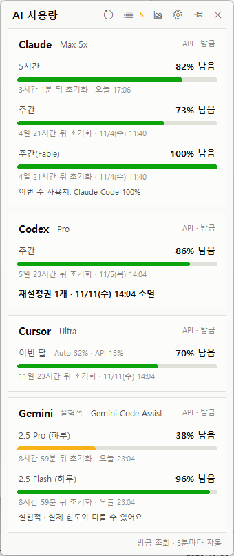
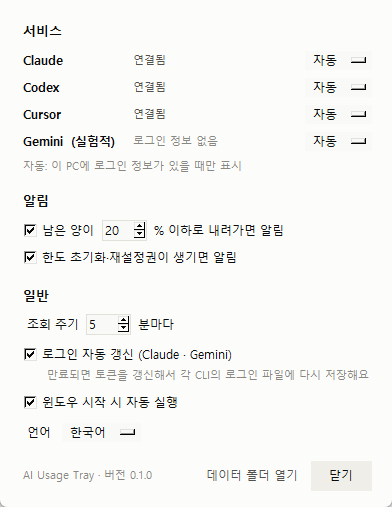
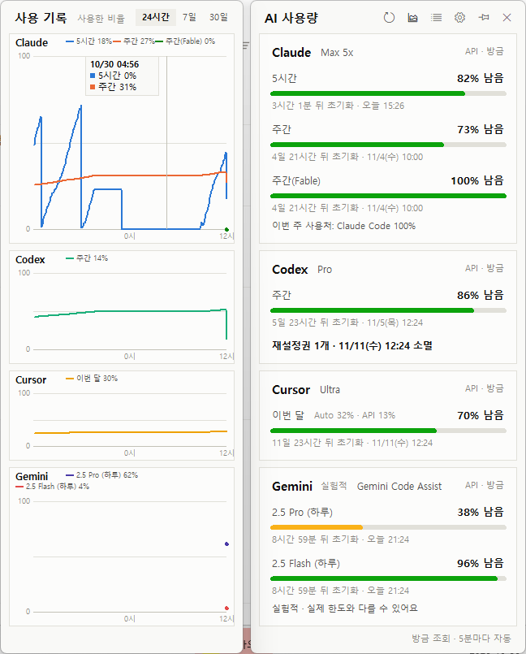

# AI Usage Tray (AI 사용량 트레이)

[English](README.md)

**Claude · Codex · Cursor · Gemini**의 남은 사용량, **초기화 시각**, **재설정권**을 각 앱 설정 화면에 들어가지 않고 Windows 트레이에서 한 번에 보는 프로그램입니다.

<p>
  
  
</p>

- 트레이 아이콘 숫자는 **가장 급한 한도의 남은 %** 입니다. 초록은 50% 넘음, 노랑은 50% 이하, 빨강은 알림 기준 이하예요.
- 아이콘을 클릭하면 서비스별 카드가 열려요. 남은 양 막대, 초기화까지 남은 시간과 시각, 재설정권이 나와요.
- **고정**하면 화면에 계속 떠 있는 위젯이 돼요. 제목 줄을 끌어서 옮길 수 있어요.
- 남은 양이 **부족할 때**, 한도가 **초기화될 때**, **재설정권이 생길 때** Windows 알림을 보내요.
- **사용 기록 그래프**(24시간 / 7일 / 30일)와 표 보기가 있어요.
- 로그인하지 않은 서비스는 자동으로 숨겨요. 화면은 한국어·영어를 지원해요.



## 지원 서비스

| 서비스 | 보여주는 것 | 사용하는 로그인 |
|---|---|---|
| Claude (Pro / Max) | 5시간·주간·모델별 주간 한도 | Claude Code CLI (`~/.claude/.credentials.json`) |
| Codex (ChatGPT 요금제) | 5시간·주간 한도, 재설정권, 크레딧 잔액 | Codex 앱 또는 CLI (`~/.codex/auth.json`). 안 되면 Codex 작업 기록을 읽어요 |
| Cursor | 이번 결제 주기(Auto / API 비율), 추가 사용 금액 | Cursor 앱 (`state.vscdb`) |
| Gemini (실험적) | 모델별 하루 요청 한도 | Google 계정으로 로그인한 Gemini CLI (`~/.gemini/oauth_creds.json`) |

Claude 재설정권은 이 프로그램이 쓰는 주소에서 제공하지 않아 표시하지 않아요(2026년 10월 기준).

## 설치

준비물: **Windows 10/11**, [python.org](https://www.python.org/downloads/)의 **Python 3.10 이상**(tkinter 포함)

```powershell
git clone https://github.com/Langrits/agent-usage-tray.git
cd agent-usage-tray
.\install.cmd
.\start.cmd
```

git이 없으면 GitHub에서 ZIP으로 내려받아 압축을 풀고, `install.cmd`와 `start.cmd`를 차례로 더블클릭하세요.

윈도우를 켤 때 자동으로 실행하려면 **설정**에서 **윈도우 시작 시 자동 실행**을 체크하세요.

## 서비스 연결

이 프로그램은 PC에 이미 있는 로그인만 읽어요. 쓰는 도구마다 한 번씩 로그인해 두세요.

- **Claude**: [Claude Code](https://code.claude.com/docs)를 설치하세요(PowerShell에서 `irm https://claude.ai/install.ps1 | iex`). 그다음 `claude`를 실행하고 **Claude account with subscription**을 골라 로그인하세요. Claude 데스크톱 앱의 로그인은 쓸 수 없어요. 암호화돼 있고, claude.ai가 브라우저가 아닌 접속을 막기 때문이에요.
- **Codex**: Codex 앱이나 CLI에 ChatGPT 계정으로 로그인하세요.
- **Cursor**: Cursor 앱에 로그인하세요.
- **Gemini (실험적)**: [Gemini CLI](https://github.com/google-gemini/gemini-cli)를 설치하고 `gemini`를 실행해 Google 계정으로 로그인하세요.

그다음 트레이 메뉴에서 **지금 새로고침**을 누르세요.

## 설정

트레이 메뉴의 **설정…** 이나 팝업의 ⚙ 버튼으로 열어요.

| 항목 | 기본값 |
|---|---|
| 서비스별 표시: 자동(로그인돼 있으면) / 항상 표시 / 숨기기 | 자동 |
| 남은 양이 …% 이하로 내려가면 알림 | 20% |
| 한도 초기화·재설정권이 생기면 알림 | 켜짐 |
| 조회 주기 | 5분 |
| 로그인 자동 갱신 (Claude · Gemini) | 켜짐 |
| 윈도우 시작 시 자동 실행 | 꺼짐 |
| 언어: 자동 / 한국어 / English | 자동 |

설정·기록·로그는 `%USERPROFILE%\.ai-usage-tray`에 저장돼요.

0.1.1까지는 `%LOCALAPPDATA%\AgentUsage`를 썼어요. 그런데 이 프로그램을 스토어(MSIX) 앱 안에서 실행하면, Windows가 그 기록을 해당 앱 전용 폴더(`%LOCALAPPDATA%\Packages\<앱>\LocalCache\Local\AgentUsage`)로 돌려 저장해요. 그래서 기록이 두 곳에 나뉠 수 있었어요. 지금 버전은 시작할 때 이 위치들의 기록을 모두 새 폴더로 합쳐요. 합친 뒤에는 예전 폴더를 지워도 돼요.

## 개인정보와 동작 방식

이 요금제들의 사용량은 공식 API가 없어서, **공식 앱이 안에서 쓰는 것과 같은 내부 주소**를 호출해요.

| 서비스 | 읽는 것 | 보내는 곳 |
|---|---|---|
| Claude | `~/.claude/.credentials.json` | `api.anthropic.com`(사용량), `platform.claude.com`(토큰 갱신) |
| Codex | `~/.codex/auth.json`, `~/.codex/sessions` (읽기만) | `chatgpt.com` |
| Cursor | Cursor의 `state.vscdb` (읽기만) | `cursor.com` |
| Gemini | `~/.gemini/oauth_creds.json` | `cloudcode-pa.googleapis.com`, `oauth2.googleapis.com`(토큰 갱신) |

- 토큰은 발급한 서비스 서버로만 보내고, 이 PC 밖 다른 곳으로는 보내지 않아요. 사용 통계도 수집하지 않아요.
- **로그인 자동 갱신**이 켜져 있으면, Claude나 Gemini 토큰이 만료됐을 때 CLI와 같은 방식으로 갱신해요. 그리고 **새 토큰을 그 CLI의 로그인 파일에 다시 저장해서** CLI도 계속 쓸 수 있게 해요. 이 파일을 프로그램이 고치는 게 싫으면 꺼 두세요. 그러면 카드에 CLI를 한 번 실행하라는 안내가 나와요.
- Gemini 토큰 갱신에 필요한 Gemini CLI의 공개 OAuth 클라이언트 값은 저장소에 넣지 않아요. 설치된 Gemini CLI에서 찾아 써요.

## 업데이트 / 삭제

- 업데이트: `git pull` 후 `install.cmd`를 다시 실행하세요.
- 삭제: 설정에서 **윈도우 시작 시 자동 실행**을 끄고, 트레이 메뉴에서 종료하세요. 그다음 프로그램 폴더와 `%USERPROFILE%\.ai-usage-tray`를 지우면 돼요. 예전 버전이 남긴 `%LOCALAPPDATA%\AgentUsage`가 있으면 그것도 지우세요.

## 문제 해결

- **카드에 "로그인이 만료됐어요"가 나와요**: 카드의 안내를 따르세요. 보통 CLI를 한 번 실행하거나 앱을 한 번 열면 돼요.
- **아무것도 안 떠요**: 데이터 폴더의 `app.log`를 확인하세요(설정 → 데이터 폴더 열기).
- **알림 발신자가 "Python"으로 보여요**: `pythonw.exe`로 실행하기 때문이에요.
- **Gemini가 100% 남음인데 요청이 막혀요**: Google의 한도 조회 주소가 부정확하다는 보고가 있어요([gemini-cli#29425](https://github.com/google-gemini/gemini-cli/issues/29425)). 그래서 Gemini는 실험적으로 표시해요.

## 면책

비공식 도구예요. Anthropic, OpenAI, Anysphere(Cursor), Google과 관계가 없고 이들의 보증을 받지 않았어요. 문서화되지 않은 주소를 쓰기 때문에 언제든 바뀌거나 동작하지 않을 수 있고, 사용은 각 서비스의 약관을 따를 수 있어요. 사용에 따른 책임은 사용자에게 있어요.

## 기여

새 서비스 추가는 파일 하나면 돼요. [CONTRIBUTING.md](CONTRIBUTING.md)를 보세요.

## 라이선스

[MIT](LICENSE)
