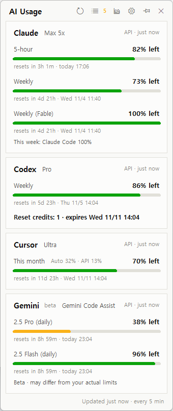
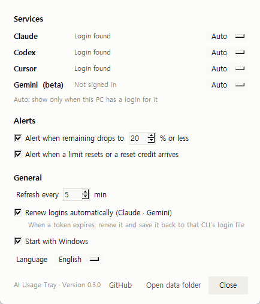
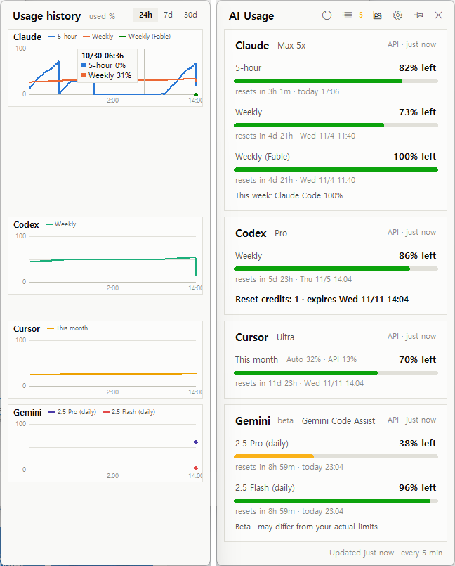
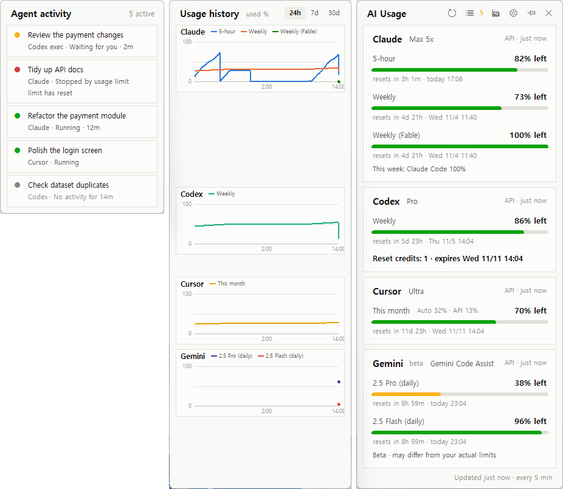

# AI Usage Tray

[한국어](README.ko.md)

A small Windows tray app that shows how much of your **Claude, Codex, Cursor and Gemini** plan limits you have left, **when each limit resets**, and whether you have **reset credits** — without opening each app's settings page.

<p>
  
  
</p>

- The tray icon shows the **lowest remaining %** across your limits (green > 50%, yellow ≤ 50%, red ≤ your alert threshold).
- Click it for a card per service: remaining bar, time until reset, reset time, reset credits.
- **Pin** the popup to keep it on screen as a widget (drag it by the title bar).
- **Alerts** when a limit runs low, when it resets, and when a reset credit arrives.
- **Usage history** panel next to the popup: a mini chart per service, lined up with its card when the whole popup fits on screen (24h / 7d / 30d). Toggle it with the chart button.
- **Agent activity** panel: only the Claude / Codex / Cursor work in progress right now (waiting for you / stopped by a usage limit / running / gone quiet). Toggle it with the list button.
- Services you are not signed in to are hidden automatically. Korean and English UI.



## Supported services

| Service | What it shows | Sign-in it uses |
|---|---|---|
| Claude (Pro / Max) | 5-hour, weekly, and per-model weekly limits | Claude Code CLI (`~/.claude/.credentials.json`) |
| Codex (ChatGPT plans) | 5-hour / weekly limits, reset credits, credit balance | Codex app or CLI (`~/.codex/auth.json`); falls back to Codex session logs |
| Cursor | This billing cycle (Auto / API split), on-demand spend | Cursor app (`state.vscdb`) |
| Gemini (beta) | Daily per-model request limits | Gemini CLI with Google sign-in (`~/.gemini/oauth_creds.json`) |

Claude reset credits are not shown: the endpoint this app uses does not report them (as of October 2026).

## Install

Requirements: **Windows 10/11** and **Python 3.10+** from [python.org](https://www.python.org/downloads/) (includes tkinter).

```powershell
git clone https://github.com/Langrits/agent-usage-tray.git
cd agent-usage-tray
.\install.cmd
.\start.cmd
```

No git? Download the ZIP from GitHub, unzip it, then double-click `install.cmd` and `start.cmd`.

To start it with Windows, open **Settings** and check **Start with Windows**.

## Connect each service

The app only reads sign-ins that already exist on your PC. Sign in once with each tool you use:

- **Claude**: install [Claude Code](https://code.claude.com/docs) (`irm https://claude.ai/install.ps1 | iex` in PowerShell), run `claude`, choose **Claude account with subscription**, and sign in. The Claude desktop app's sign-in can't be used: it is encrypted, and claude.ai blocks non-browser requests.
- **Codex**: sign in to the Codex app or CLI with your ChatGPT account.
- **Cursor**: sign in to the Cursor app.
- **Gemini (beta)**: install [Gemini CLI](https://github.com/google-gemini/gemini-cli), run `gemini`, and sign in with Google.

Then click **Refresh now** in the tray menu.

## Agent activity

Toggle it with the list button in the popup header or **Agent activity** in the tray menu. The number next to the button is how many items are in progress (yellow when one is waiting for you). The panel docks left of the popup, outside the usage history panel when that is open.



- **Only work in progress** is listed. Finished work drops off.
- **Status**: waiting for you (a question or an approval) · stopped by usage limit (with when that service's limit resets, or *limit has reset*) · running (how long since the request started) · *no activity for N min* (running, but nothing logged for over 10 minutes. It does not claim the work is stuck, it only shows how long the log has been quiet, and drops off after 2 hours).
- **Only what the apps log themselves** is used: request start and end, question and approval waits, and usage-limit hits from Claude Code and Codex, and the generating state and approval or plan waits of Cursor editor chats. Work without such records (for example the Cursor agent CLI) is not guessed and not shown. When the start time is not in the log, no duration is shown.
- Click a row to open a Claude desktop conversation in the app, or a Cursor chat's project in Cursor. Codex has no link to a conversation, so its rows are not clickable.
- While the popup is open it re-reads the logs every 15 seconds.

## Settings

Open **Settings…** from the tray menu or the ⚙ button in the popup.

| Setting | Default |
|---|---|
| Show each service: Auto (when signed in) / Always / Hide | Auto |
| Alert when remaining drops to … % | 20% |
| Alert when a limit resets or a reset credit arrives | On |
| Refresh every … minutes | 5 |
| Renew logins automatically (Claude · Gemini) | On |
| Start with Windows | Off |
| Language: Auto / 한국어 / English | Auto |

Settings, history and logs live in `%USERPROFILE%\.ai-usage-tray`.

Versions up to 0.1.1 used `%LOCALAPPDATA%\AgentUsage`. When the app was started from inside a Microsoft Store (MSIX) app, Windows redirected those writes to that app's private folder (`%LOCALAPPDATA%\Packages\<app>\LocalCache\Local\AgentUsage`), so history could end up split in two places. On start the app merges the history from all of these into the new folder (it tries again on the next start if an old folder couldn't be read). Once your older history shows up in the app, you can delete the old folders.

## Privacy and how it works

There are no official usage APIs for these plans, so this app calls **the same internal endpoints the official apps use**.

| Service | Reads | Sends to |
|---|---|---|
| Claude | `~/.claude/.credentials.json` | `api.anthropic.com` (usage), `platform.claude.com` (token renewal) |
| Codex | `~/.codex/auth.json`, `~/.codex/sessions` (read only) | `chatgpt.com` |
| Cursor | Cursor's `state.vscdb` (read only) | `cursor.com` |
| Gemini | `~/.gemini/oauth_creds.json` | `cloudcode-pa.googleapis.com`, `oauth2.googleapis.com` (token renewal) |

- Tokens never leave your PC except to the service that issued them. Nothing is sent anywhere else, and there is no telemetry.
- **Agent activity** only reads log files on this PC (`~/.claude/projects`, `%APPDATA%\Claude\claude-code-sessions`, `~/.codex/sessions`, Cursor's `state.vscdb`). It makes no network requests and never changes those files. Large logs are read only at the start and end. Rows show the conversation title, or the first part of a request (up to 60 characters) when there is none.
- With **Renew logins automatically** on, when a Claude or Gemini token has expired the app renews it the same way the CLI does and **writes the new token back to that CLI's login file**, so the CLI keeps working. Turn it off if you don't want the app to modify those files; the card will then ask you to run the CLI once.
- For Gemini renewal, the app looks up Gemini CLI's public OAuth client values in your installed Gemini CLI rather than shipping them.

## Update / uninstall

- Update: `git pull`, then run `install.cmd` again.
- Uninstall: turn off **Start with Windows** in Settings, quit from the tray menu, then delete the folder and `%USERPROFILE%\.ai-usage-tray` (and `%LOCALAPPDATA%\AgentUsage` if an older version left it).

## Troubleshooting

- **"login expired"** on a card: follow the hint on the card (usually: run the CLI once, or open the app).
- **Nothing appears**: check `app.log` in the data folder (Settings → Open data folder).
- **Notifications say "Python"**: the app runs with `pythonw.exe`, so Windows shows that name.
- **Gemini shows 100% left but requests fail**: Google's quota endpoint is known to be unreliable ([gemini-cli#29425](https://github.com/google-gemini/gemini-cli/issues/29425)); that's why Gemini is marked beta.

## Disclaimer

This is an unofficial tool. It is not affiliated with or endorsed by Anthropic, OpenAI, Anysphere (Cursor) or Google. It relies on undocumented endpoints that can change or break at any time, and their use may be subject to each service's terms. Use it at your own risk.

## Contributing

Adding a new service is one file. See [CONTRIBUTING.md](CONTRIBUTING.md).

## License

[MIT](LICENSE)
